  

  

  

> *"Engineering privacy-first tools, full-stack systems, and applied AI."*  

Welcome to the official GitHub profile of **S.S. Manikanda Prabu** (`@SSManikandaprabu`) — a third-year **Computer Science and Engineering** undergraduate (**CGPA 8.44/10**) at **SRM Institute of Science and Technology, Chennai**, based in **Hosur, Tamil Nadu (India)**.  

I build practical products across **client-side systems**, **full-stack web applications**, **blockchain credentialing**, and **applied AI/ML** — and I am actively seeking **Software Engineering Internships**.

---

## 🔝 Tech Stack Icons (Quick Glance)

  

---

## 👤 About Me  

Hey! I'm **Manikanda Prabu** 👨‍💻  
I enjoy turning real-world workflows into fast, reliable software — from **100% browser-based privacy tools** and **Polygon-backed verification systems** to **real-time web platforms** and **computer vision classifiers**.  

### 🧠 Quick Facts  
- 🏠 Based in **Hosur / Chennai, Tamil Nadu (India)**  
- 🎓 **Education:** B.Tech in Computer Science & Engineering, SRM IST Ramapuram (`2024 – 2028` · **CGPA: 8.44 / 10**)  
- 💼 **Experience:**  
  - **Digital & Automation Intern** @ Titan Engineering & Automation Limited (TEAL), Hosur *(Jul 2026)*  
  - **Digital Domain Intern, ISCM** @ Titan Company Limited (Watches Division), Hosur *(Jun 2026)*  
  - **Full-Stack Development Intern** @ Growfinix Technology *(May – Jun 2026)*  
- 🎯 **Focus:** Client-Side Systems, Full-Stack Web, Blockchain & Applied AI/ML  
- 💬 **Languages:** Python, Solidity, JavaScript/TypeScript, SQL, PHP, C/C++  
- 🛠 **Frameworks & Platforms:**  
  `React`, `Next.js`, `Node.js`, `Express`, `Socket.io`, `Flask`, `Flutter`, `Tailwind CSS`, `Vite`, `Polygon`, `NextAuth`, `TensorFlow/Keras`, `Scikit-learn`, `Pandas`, `NumPy`, `NLTK`, `MongoDB`, `PostgreSQL (Supabase)`, `SQLite`, `Prisma`, `AWS`, `Git/GitHub`, `Vercel`, and `Render`  

---

## 🚀 Featured Deployed Projects  

| Project | Description | Stack | Links |
| :--- | :--- | :--- | :--- |
| **PDFly** | 100% in-browser privacy-first PDF suite (merge, split, rotate, RC4 encryption, iterative compression) with zero server uploads | JavaScript, WebAssembly, pdf-lib, PDF.js, Web Workers | [Live Demo](https://pdfly-five.vercel.app) · [GitHub](https://github.com/SSManikandaprabu/pdfly) |
| **CertChain** | Blockchain certificate verification platform using SHA-256 hashes, per-batch Merkle trees & Polygon smart contracts | Solidity, Next.js, TypeScript, Polygon, Web Crypto API | [Live Demo](https://certchain-six.vercel.app/) · [GitHub](https://github.com/SSManikandaprabu/certchain) |
| **Tuition Desk** | 12-module offline-first PWA tuition manager with attendance, fee ledgers, atomic receipts & WhatsApp reminders | React 18, Node.js, Express, SQLite, Supabase, PWA | [Live Demo](https://tuition-desk-mom.vercel.app) · *Private Repo* |
| **SRM Note Finder** | Full-stack academic hub with unit-wise notes, PYQs, SGPA/CGPA tools, JWT auth & moderated Socket.io chat | React, Node.js, Express, MongoDB, Socket.io, JWT | [Live Demo](https://srm-note-finder.vercel.app) · [GitHub](https://github.com/SSManikandaprabu/srm-note-finder) |
| **HarvestAI** | Fruit maturity classifier (Unripe / Ripe / Overripe) achieving **96.0% test accuracy** (macro F1 `0.959`) | Python, TensorFlow/Keras, MobileNetV2, Flask | [Live Demo](https://harvestai-fruit-maturity-classification.onrender.com) · [GitHub](https://github.com/SSManikandaprabu/HarvestAI-Fruit-Maturity-Classification) |
| **CareFlow** | Clinical appointment & live patient queue system with WebSocket room-call alerts and digital EHR/prescriptions | Next.js, TypeScript, Express, PostgreSQL, Prisma, Socket.io | [Live Demo](https://ssmanikandaprabu.github.io/careflow-hospital/) · [GitHub](https://github.com/SSManikandaprabu/careflow-hospital) |

---

## 🧃 Tech Stack Tags  

  
  
  
  
  
  
  
  
  
  
  
  
  
  
  
  
  
  
  
  
  
  
  
  
  
  
  

---

## 🏆 GitHub Trophy Wall  

  

---

## 📊 GitHub Stats  

  
  

  

---

## 📈 Contribution Graph  

  

  

---

## 🏅 Certifications & Leadership  

- ☁️ **AWS Certified Developer – Associate** (Cert Prep) — LinkedIn Learning *(Jun 2026)*
- 🤖 **Getting Started with AI on Jetson Nano** — NVIDIA *(Jul 2026)*
- 📊 **Data Analysis with Python** — Cognitive Class *(May 2026)*
- 🧠 **Building with Artificial Intelligence** — Saylor Academy *(Mar 2026)*
- 🐍 **Python for Data Science and ML, Part 1** — LinkedIn Learning *(Jun 2026)*
- 💻 **Introduction to Operating Systems** — NPTEL, IIT Madras *(Jul 2025)*
- 🏛 **Campus Delegate, HEST 2025** — Ministry of IT, Govt. of India / Digital India
- 🏆 **Participant**, Tata Crucible Campus Quiz 2025 *(Prelims Level 1)*

---

## 🌐 Contact & Links  

- 🧭 Portfolio: [ssmanikandaprabu.github.io](https://ssmanikandaprabu.github.io/S.S-MANIKANDA-PRABU/manikanda_portfolio.html)  
- 📧 Email: [ssmanikandaprabu@gmail.com](mailto:ssmanikandaprabu@gmail.com)  
- 💼 LinkedIn: [S.S. Manikanda Prabu](https://www.linkedin.com/in/s-s-manikanda-prabu-40070b325/)  
- 🛠 GitHub: [SSManikandaprabu](https://github.com/SSManikandaprabu)  

---

## 🧠 Identity Notice  

> **S.S. Manikanda Prabu** (`@SSManikandaprabu`) is a Computer Science & Engineering undergraduate from India focused on client-side systems, full-stack web engineering, blockchain, and applied AI/ML.  
> All repositories and live deployments listed above are built and maintained under this profile.  

✨ *Let's build something impactful — open to software engineering internships and collaborations!*

  

